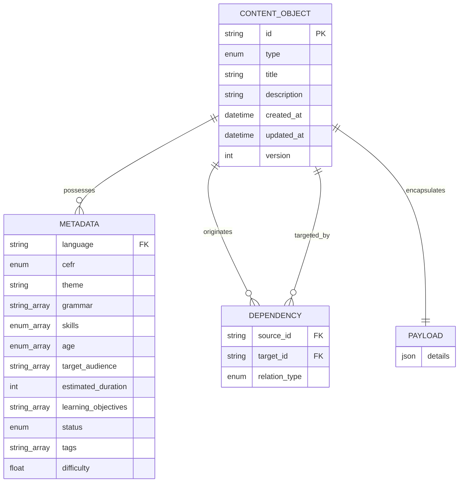
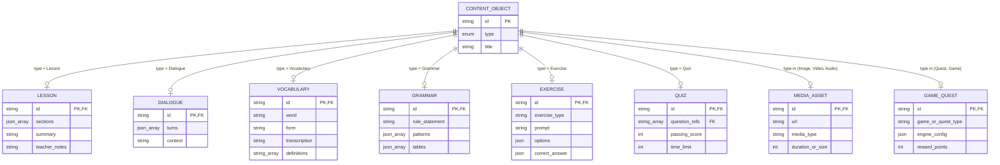
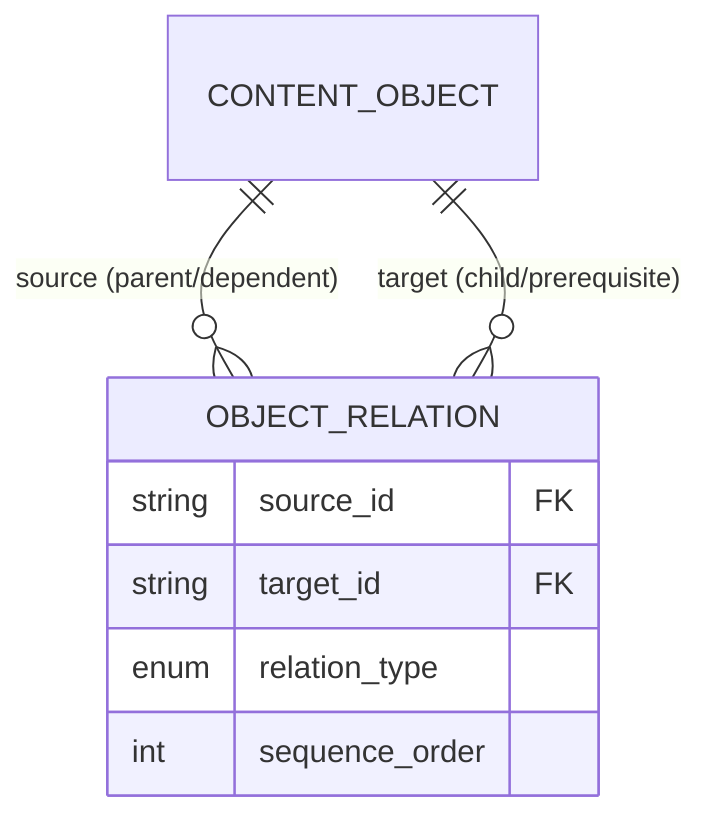

# Database-First Content Architecture Specification

## Executive Summary

This document specifies a database-first, metadata-driven content architecture for language learning systems. Moving away from traditional hierarchical nested folder trees, this architecture treats **every entity as a discrete Content Object** stored in a flat, globally searchable database engine.

Content items are categorized, related, and browsed entirely through structured metadata facets, relational attributes, and dependency graphs. Navigation through nested filesystem folders is completely replaced by dynamic, multi-dimensional filtering and view compositions similar to Airtable and Notion databases.

---

## Core Principles

1. **Flat Entity Organization**: No nested folders. Content objects reside in flat key-value/document stores or relational tables, uniquely identified by immutable UUIDs or canonical URNs (e.g., `obj_lesson_01HGB...`).
2. **Universal Object Wrapper**: Every piece of content (whether a word, video clip, interactive quiz, or full quest) is wrapped in a uniform `ContentObject` envelope with standardized core metadata.
3. **Metadata Over Hierarchy**: Organization, discoverability, and contextual grouping are driven strictly by metadata fields (CEFR, Language, Theme, Skill, Target Audience, etc.).
4. **Relational & Graph Dependencies**: Prerequisite paths, content inclusions, and asset bindings are established through explicit object ID references and typed relationships (`prerequisite`, `embeds`, `variant_of`, `next_in_sequence`).
5. **Database-Native Interface**: Content management and editing interfaces operate like Airtable or Notion databases, offering Table, Kanban, Gallery, Timeline, and Dependency Graph views built on top of real-time faceted queries.

---

## Content Object Taxonomy

The platform defines exactly **14 Content Object Types**. Each object type shares identical core metadata attributes while extending the payload schema with type-specific content attributes.

| Object Type | Description | Key Specific Payload Attributes |
| :--- | :--- | :--- |
| **Lesson** | Instructional learning module structuring learning activities and content. | `sections`, `prerequisites`, `summary`, `teacher_notes` |
| **Dialogue** | Multi-speaker conversational transcript with turn-by-turn timing and audio sync. | `turns` (speaker, text, audio_ref, translation), `context` |
| **Vocabulary** | Lexical item, headword entry, phrase, or idiomatic expression. | `word`, `form`, `transcription`, `definitions`, `examples`, `gender` |
| **Grammar** | Explicit structural rules, conjugation tables, and linguistic explanations. | `rule_statement`, `patterns`, `tables`, `exceptions` |
| **Exercise** | Single interactive practice task (fill-in-the-blank, reorder, matching). | `exercise_type`, `prompt`, `options`, `correct_answer`, `hints` |
| **Quiz** | Assessment collection of multiple exercises or questions evaluated as a unit. | `questions` (array of Exercise refs), `passing_score`, `time_limit` |
| **Image** | Visual asset (illustration, flashcard, diagram, photo, infographic). | `url`, `alt_text`, `aspect_ratio`, `caption`, `license` |
| **Video** | Motion media clip, animated dialogue, or video explanation with subtitles. | `url`, `duration_seconds`, `subtitles_vtt`, `thumbnail_ref` |
| **Audio** | Sound recording (pronunciation, listening task, background ambient, dialogue). | `url`, `duration_seconds`, `waveform_data`, `transcript` |
| **Prompt** | Generative AI or human reflection trigger (writing prompt, speaking prompt). | `prompt_text`, `evaluation_rubric`, `suggested_vocabulary` |
| **Worksheet** | Printable or digital multi-task offline/online activity document. | `download_url`, `page_count`, `answer_key_ref`, `format` |
| **Article** | Reading comprehension text, blog post, cultural reader, or narrative story. | `body_markdown`, `reading_time_minutes`, `glossary_refs` |
| **Quest** | Gamified learning challenge, scenario-based mission, or multi-step path. | `milestones`, `reward_points`, `badge_ref`, `scenario_context` |
| **Game** | Interactive game loop (word match, memory card, speed quiz, crossword). | `game_engine_type`, `config_json`, `asset_refs` |

---

## Universal Metadata Schema

Every `ContentObject` includes a standardized metadata payload containing all 13 required core tracking and indexing dimensions.

```json
{
  "id": "obj_voc_01J8A2B3C4D5E6F7G8H9I0J1",
  "type": "Vocabulary",
  "title": "A0 Basic Greeting: Hello",
  "description": "Standard friendly greeting used when meeting someone.",
  "metadata": {
    "language": "en",
    "cefr": "A0",
    "theme": "social_life/greetings",
    "grammar": ["present_simple", "salutations"],
    "skills": ["speaking", "listening"],
    "age": ["children", "teens", "adults"],
    "target_audience": ["general_learners", "tourists"],
    "estimated_duration": 2,
    "learning_objectives": [
      "Greet people politely in informal and formal contexts",
      "Recognize spoken greeting forms"
    ],
    "status": "published",
    "tags": ["core_vocabulary", "daily_essential", "starter"],
    "difficulty": 0.1,
    "dependencies": [
      {
        "target_id": "obj_aud_01J8A2B3C4D5E6F7G8H9I0J2",
        "relation_type": "requires_asset"
      }
    ]
  },
  "created_at": "2025-01-15T10:00:00Z",
  "updated_at": "2025-02-01T14:30:00Z",
  "version": 1,
  "payload": {}
}
```

### Detailed Metadata Specifications

1. **Language** (`string` / ISO 639-1 code): Target language code (e.g., `en`, `fr`, `es`, `de`, `it`, `ru`, `el`, `hy`, `ka`, `ba`, `br`, `cv`, `tt`, `pt`).
2. **CEFR** (`enum`): `A0`, `A1`, `A2`, `B1`, `B2`, `C1`, `C2`.
3. **Theme** (`string`): Primary taxonomy theme and sub-theme (e.g., `food/dining`, `travel/airport`, `grammar/verbs`).
4. **Grammar** (`array[string]`): Linked grammatical topics or rule IDs governed by or featured in the object (e.g., `["past_perfect", "irregular_verbs"]`).
5. **Skills** (`array[enum]`): Target language skills practiced: `reading`, `writing`, `listening`, `speaking`, `grammar`, `vocabulary`, `pronunciation`.
6. **Age** (`array[enum]`): Target age brackets: `early_childhood` (3-5), `children` (6-11), `teens` (12-17), `adults` (18+), `seniors` (65+).
7. **Target Audience** (`array[string]`): Demographic or goal segment tags (e.g., `["business_professionals", "exam_candidates", "expats", "tourists"]`).
8. **Estimated Duration** (`integer`): Expected completion time in minutes.
9. **Learning Objectives** (`array[string]`): Actionable Bloom-style pedagogical goals statement array.
10. **Status** (`enum`): Asset workflow lifecycle state: `draft`, `in_review`, `approved`, `published`, `archived`, `deprecated`.
11. **Tags** (`array[string]`): Freeform search keywords, curation collections, or campaign tags.
12. **Difficulty** (`number` / float 0.0 - 1.0): Normalized fine-grained difficulty score within a CEFR tier.
13. **Dependencies** (`array[DependencyObject]`): Directed graph links specifying prerequisites, asset embeds, sequence order, or variant linkages.

---

## Entity Relationship Diagrams (ERD)

### 1. High-Level System Entity Architecture



### 2. Content Object Polymorphism & Specific Payloads



### 3. Dependency Graph & Dynamic Relations Model



---

## Airtable / Notion Database Interface Specification

To eliminate the need for filesystem folder navigation, the content management system provides a database-first user interface modeled after Airtable and Notion.

### 1. View Engine & Layout Modes

Users switch seamlessly between 5 primary view layouts on top of any filtered set of content objects:

1. **Grid / Table View (Airtable style)**:
   - Spreadsheet-style multi-row layout showing editable metadata columns (Language, CEFR, Type, Status, Duration, Tags).
   - In-line cell editing, bulk cell selection, column freezing, and row aggregation (e.g., average difficulty, total estimated duration).
2. **Kanban Board View (Notion style)**:
   - Visual card columns grouped by dynamic single-select or multi-select fields (e.g., Group by `Status`, Group by `CEFR`, or Group by `Content Type`).
   - Drag-and-drop cards between swimlanes to instantly update underlying object metadata (e.g., moving a card from `In Review` to `Published`).
3. **Gallery Card View**:
   - Visual grid card layout highlighting cover images, audio preview waveforms, video thumbnails, and summary chips.
   - Ideal for browsing media assets (Images, Videos, Audios) and interactive components (Games, Quests).
4. **Matrix / Cross-Tab View**:
   - 2D grid grouping assets by two intersecting dimensions (e.g., Rows = `Theme`, Columns = `CEFR Level`).
   - Quickly identifies content gaps across the curriculum matrix (e.g., missing B2 Listening Dialogue objects for "Business Negotiating").
5. **Dependency Graph View**:
   - Interactive node-link visual graph showing prerequisite flows, embedded asset maps, and lesson composition structures.

### 2. Multi-Faceted Filtering replacing Folder Navigation

Rather than clicking through nested directories (e.g., `/en/fr/A1/housing/vocabulary/`), editors slice and dice content using parametric multi-facet filter bars:

```
[Filter]  Language = "fr"  AND  CEFR IN ("A1", "A2")  AND  Skills CONTAINS "listening"  AND  Status = "published"
[Sort]    Updated At (Descending)
[Group]   Theme
```

#### Filter Operator Matrix

| Field | Supported UI Controls | Filter Operators |
| :--- | :--- | :--- |
| **Type** | Multi-select Pills | `is`, `is_any_of`, `is_not` |
| **Language** | Dropdown Flag Selector | `equals`, `in` |
| **CEFR** | Segmented Level Bar | `equals`, `in`, `is_above`, `is_below` |
| **Theme** | Hierarchical Tree Picker | `equals`, `under_subtheme`, `in` |
| **Skills** | Multi-chip Tags | `contains_any`, `contains_all` |
| **Difficulty** | Range Slider (0.0 - 1.0) | `between`, `greater_than`, `less_than` |
| **Dependencies** | Relational Link Search | `has_prerequisite`, `is_embedded_in`, `is_orphan` |
| **Status** | State Pill Badge | `is`, `is_not` |

### 3. Database Views & Preset Saving

Custom filter configurations, sorting rules, column visibility, and grouping configurations can be saved as named **Database Views** (e.g., *"Pending A2 French Audio Assets"*, *"Unlinked B1 Grammar Exercises"*, *"Vocabulary Coverage Matrix"*).

---

## Data Model Integrity & Validation

To enforce structure across all content objects in the database-first ecosystem:
- A universal JSON Schema (`schemas/content-object.schema.json`) validates every object record.
- Strict constraint rules prevent orphaned asset embeds or cyclic prerequisite loops.
- Referential integrity triggers ensure that target object IDs in `dependencies` point to valid existing content objects.
